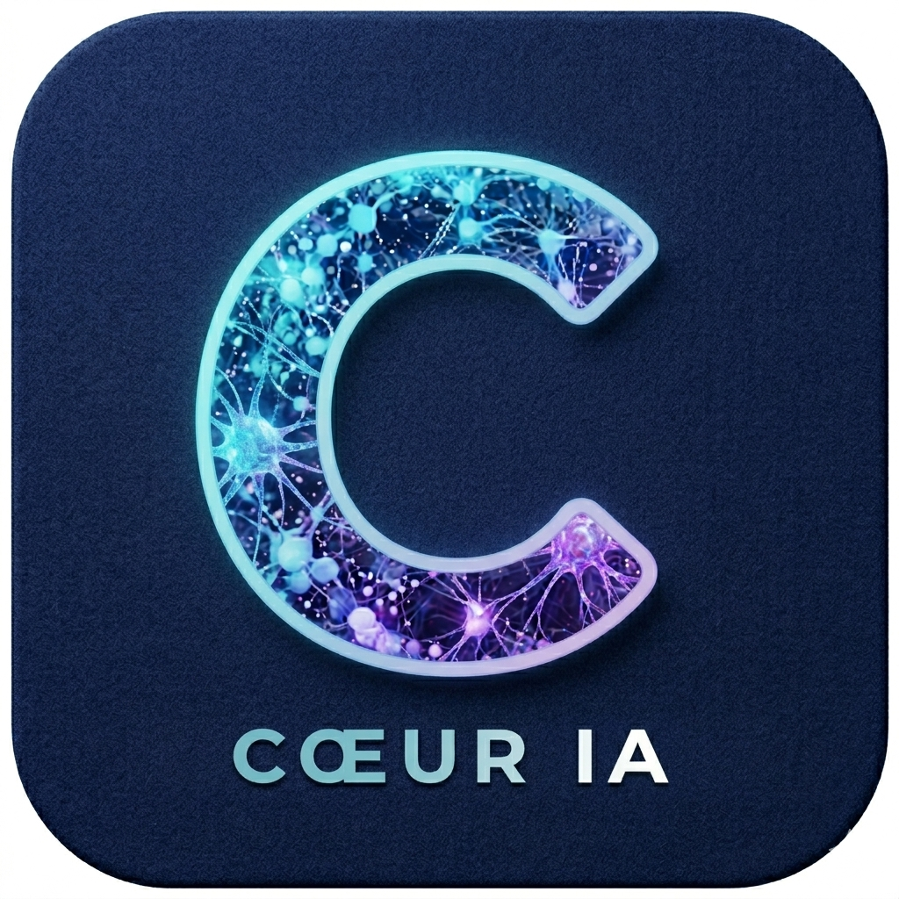

<p align="center">
  
</p>

<h1 align="center">AIODOS</h1>

<p align="center"><b>The way of AI, made together.</b><br>
AI that runs on the pooled power of its participants: your machines, your friends' machines,
and strangers' machines around the world. No central server, no cloud.</p>

<p align="center">
  <a href="LICENSE"></a>
  
  
  
</p>

<p align="center"><i>Version française : <a href="README.fr.md">README.fr.md</a>.</i></p>

AIODOS connects, over the Internet, the machines of people
who don't know each other, to run AI on their pooled power: those of public network
participants, of your friends, and your own (PCs, phone), with no central server; the local
network is only a shortcut. Each large job is split into small units that free machines share, like
the pieces of a torrent; a model too large for a single graphics card is split across
several.

- **Chat, code, search your documents** with open models (Mistral, Qwen…), served by
  llama.cpp, built into AIODOS (or by [Ollama]); the AI cites its sources.
- **Create images, videos and audio** (voice, music, sound effects) in the conversation,
  with today's best open models (FLUX 3 Image Klein, Qwen-Image, LTX-2.5, Wan 2.2,
  ACE-Step…), computed by the machines that have them.
- **"Automatic", everywhere**: for text, images, videos and audio, AIODOS takes the most
  powerful model that an available machine can run right now, wherever it is, then goes
  down the list; you can always pick a specific model (one "Model" button, four tabs).
- **Plug in your applications and tools** (PANDORA, ARKLIGHT PC, a code editor, an
  assistant…): they benefit from the same shared power.

> **Everyone's power, pooled over the Internet.** From the first opening, your machine joins
> the public network: strangers can answer your conversations without knowing who you are,
> and your machine answers theirs, within the power lent (60% by default, never on battery).
> A phone without any model can thus chat thanks to the network's machines. Your paired
> machines compute together and your graphics card creates images for the friends you add.
> Everything can be turned off in one gesture, and a conversation can stay on your machines
> only. Between machines, everything is encrypted, and nothing is kept by the one that
> computes. Never any cloud; the web remains optional, and each search is confirmed first.

*AI* + *hodos*: Greek for “the way”, as in “method” and “synod” (travelling together).

AIODOS speaks French and English: it follows the language of the system (browser, Windows,
Android), English when that language is neither, and it can be changed in Settings →
Language.

> **Status: in active development.** First pre-release, unsigned: the Windows installer and
> the Android app are in the [releases](https://github.com/AIODOS/aiodos/releases).
> Choices and measurements are written down as we go in [docs/](docs/), in French.

## Where the project stands

| Phase | Content | Status |
|---|---|---|
| 0 — Foundations | Local node, task queue, interface, libraries | ✅ done |
| 1 — Local network | Machine discovery, pairing, distribution, power sharing, models lent for conversations | ✅ done |
| 2 — Circle of trust | Friends' machines over the Internet (NAT traversal) | in progress: Internet companion [`aiodos-net`](compagnon/README.md) (2.2), remote invitation (2.4), sharing with friends (2.5), searchable libraries, automatic updates approved on a second device, large models split across my machines (prototype), distributed images and videos (created in the conversation), flexible reciprocity, keys protected on disk (2.3), group pairing: a friend paired with one of my machines meets the others, with their consent ([docs/appairage-groupe.md](docs/appairage-groupe.md), in French) |
| 3 — Public network | Strangers compute conversations, images and videos; result verification, incentives, governance | conversations, images and videos done (10/28-29/2026): anonymous requester (a throwaway key per request, through a relay), consent asked once, random checks and reputation against cheating and collusion, public identities costly to forge, a filter for forbidden descriptions, a history without content of what your machine computes for others ([docs/conception/reseau-public-calcul.md](docs/conception/reseau-public-calcul.md)); incentives and governance being designed: [docs/phase3-reseau-public.md](docs/phase3-reseau-public.md), [docs/phase3-incitation.md](docs/phase3-incitation.md) (in French) |

The documents in `docs/` are written in French.

## What phase 0 does

- **Conversations** with the models of your machines (no cloud model), streamed answers,
  Markdown rendering and code highlighting, folders, renaming, search in their content;
  “Regenerate” the last answer (with the model chosen at that moment) and “Edit” the last
  message, the rest of the conversation and its trace in memory being erased.
- **Attachments** (paperclip, file dropped on the conversation, pasted image): an image, a
  video, a sound, a document or a text. The model reads their text with the question
  (document, described image, transcribed sound or video); a model of this PC that sees
  images receives them as they are; an image creation starts from the attached image,
  keeping its composition. They stay on this PC and go with their conversation.
- **Model reasoning** (Qwen3…) shown live, can be turned off to go faster.
- **Knowledge libraries**: files, whole folders, web pages; all formats (PDF, Word,
  Excel, PowerPoint, code…), images (OCR + description by a vision model) and
  audio/video (Whisper transcription). The AI cites its sources. Changing the embedding
  model starts the reindexing by itself.
- **Memory across conversations** (optional).
- Persistent **task queue**: priorities (urgent / normal / background) then order of
  arrival, pause, cancellation, retries, automatic resumption after an outage. A
  conversation always goes before background work.
- **Node profile**: GPU, VRAM, installed models (and those that do not fit in VRAM),
  mains power/battery, idle time.

## Making several machines work together (phase 1)

1. **The local network** is on from the first opening (Network view, to turn it off).
   Windows asks for the firewall permission for Python: accept it for **private networks**
   only.
2. **Pair**: the AIODOS machines of the network show up by themselves (otherwise, add
   them by IP address). A 6-digit code appears on both screens: pairing only succeeds
   if it is confirmed **on each of the two machines**. **Behind a VPN** (NordVPN…):
   AIODOS announces itself on each real local network (Wi-Fi, Ethernet) and shows the
   address of the real network card, not the VPN's (`network/interfaces.py`). The VPN
   only has to let the local network through: with NordVPN, “Invisibility on LAN” turned
   off. Otherwise, machines already paired go through the Internet by themselves; a new
   one pairs by invitation.
3. **Lend your computing power** (“This machine” view): plugged in only, by default.
   While you use the PC, the lent computing goes on at low priority, never on battery,
   the graphics card half of the time at most; a conversation goes first: the GPU comes
   back to it. “Only when I'm not using this PC” keeps it for idle times (10 minutes by
   default), like a screensaver: as soon as the user comes back, the units in progress
   are handed back.
4. **See who is there** (Network view, “Connected machines”; number of machines online at
   the right of the bottom bar): like the peer list of a BitTorrent client, a single
   collapsible block for every machine, each one once, with filters (public network, my
   machines, friends, local network). One short line per machine (a stranger on the
   public network is only shown by the first 8 characters of its key), which unfolds: its
   path (local network, Internet directly or through a relay) and its response time, what
   it lends (its power, paused or not, its models, its graphics card), what it computes
   for you and you for it right now, the computing time exchanged, and its actions (pair,
   check a code, unpair…). A friend only sees whether your sharing is on, not your
   activity.

How the work flows:

- **“Pull” model**: the machine with free power asks for work. It is given a unit for a
  limited time (a lease renewed while it computes); without news, the unit goes back to
  the queue. Its own work always comes before the others'.
- **What leaves**: the file of the unit given out, and only that file, encrypted
  (ChaCha20-Poly1305, a key specific to each pair of machines), checked by its SHA-256
  hash and deleted as soon as the computing is done. **What comes back**: the passages
  and their vectors, checked and then stored **only at the owner's**.
- **Same embedding model required**, down to its hash: otherwise the vectors would not
  be comparable. A machine also only receives the documents it can read (reading
  packages installed there). The conversation memory never leaves its machine, and a
  library can be **kept on this PC only** (⋯ menu, padlock).
- **Reciprocity**: each machine keeps count of the computing time given and received;
  those that computed the most for you are served first.

**Lending your models for conversations** (“This machine” view, on by default between my
machines): a
machine without a GPU, or whose model does not fit in memory, has its conversations
answered by the model of another machine. The answer is computed there and arrives as an
encrypted stream, piece by piece; the Stop button stops the generation there. The text of
the conversation goes through the lending machine for the time of the answer, without
being stored there, and its background work pauses meanwhile.

**The answering machine chooses itself**: in the model choice, each model appears only
once, in “automatic” mode. The conversation goes to this machine if it has the model and
is free (unless the model does not fit in its video memory while another free machine
can fit it), otherwise to the least busy of your machines that lend it; each answer says
which machine computed it, and a machine that does not answer gives way to the next one.
You can also pick a specific machine, next to the model. A friend's machines only answer
by default if you accept it (Settings → Conversation). Whatever the machine, a library
kept on this PC and the conversation memory never follow it, nor the answers that used
them, nor those that may have reused them later in the same conversation (the history
sent replaces them with a note); at a friend's, only the libraries shared with your
friends give their excerpts.

**Opening AIODOS to applications** (PANDORA, ARKLIGHT PC…): each app asks for access by
itself; a card shows up in AIODOS with a 6-digit code to compare, what it will be able to
do and where its computing may take place (this PC, my machines, my friends, strangers on
the public network), to untick if needed. The gateway listens from the first launch (on
this PC only), but nothing gets in without that approval; each app has its own key,
removable in one click. Dependency-free client libraries, Python and
JavaScript, under Apache-2.0 (`clients/`): [docs/integrer-aiodos.md](docs/integrer-aiodos.md),
reference [docs/api-applications.md](docs/api-applications.md) (in French).

**Opening AIODOS to other tools** (Settings → Applications and other tools, off by
default): an OpenAI- and Ollama-compatible API, and an MCP server, on this machine only
(`127.0.0.1`, fixed port 11435, general key or a “by hand” key per tool). Open WebUI,
AnythingLLM, Continue, a code editor
or an assistant (Claude Desktop, Claude Code…) find there the models of this machine and
those your machines lend you, with the same automatic choice, and search your libraries.
**Without Ollama**: the built-in engine (llama.cpp) serves these APIs itself, tools (*tool
calling*), images, enforced response format, code completion and embeddings included;
what it cannot do is clearly refused. Step by step:
[docs/autres-outils.md](docs/autres-outils.md) (in French).

A machine dedicated to computing can run without a window: `python -m aiodos --headless`.
`--slots embed=1,gpu=0` limits what it runs in parallel, and `requirements-node.txt` is
enough to install it (no window, no Whisper).

**Background work comes after the user**: indexing and computing for the other machines
run at low priority (and on Windows, in the processor's efficiency mode); during a
conversation, computing on the graphics card waits for the end of the answer; on
battery, it is eased (one unit at a time per resource, breaks, fewer computing threads),
or waits for mains power, as you choose. Measurements and details:
[docs/arriere-plan.md](docs/arriere-plan.md) (in French).

**An Android phone** can compute too, with the AIODOS app, which runs the node itself
(nothing else to install): it only lends its power while charging, with a battery charged
enough and not too hot, like BOINC on Android. Step by step:
[docs/android.md](docs/android.md) (in French).

**With friends (phase 2)**: when confirming a pairing, each machine says whether the other
is one of its own or a friend's. A friend only receives the libraries you share with your
friends (“Also share with my friends”, ⋯ menu of the library), under neutral file names,
without path or library name,
and only sees a reduced profile of your machine. What they compute is checked by
sampling: in case of a mismatch, their machine is set aside. The Network view shows what
was given to them. A friend who is not on your network pairs by invitation (Network view,
“Internet” card): you send them a code, they send back their answer, and you each confirm
the same 6-digit code. Details: [docs/phase2-internet.md](docs/phase2-internet.md), steps
2.4 and 2.5 (in French).

**Searching other people's libraries, without copying their files**: a library can be
“searchable by” my machines, or my machines and my friends (⋯ menu; nobody by default).
In an open library, you close a specific folder or document (crossed-out eye), and a
library kept on this PC is never searchable. On the asking side, the conversation's
“Other machines” option, or the search of the Libraries view, sends the question to the
machines that open something to it (with your consent for a friend): each one searches at
home, with its own model, and only returns a few passages, cited with the name of the
machine. At most 8 passages per search and 10 searches per minute; each search received is
noted in the Network view, without the question. Details:
[docs/phase2-internet.md](docs/phase2-internet.md), “Bibliothèques consultables” (in
French).

**Over the Internet (phase 2, in progress)**: a small companion program,
[`aiodos-net`](compagnon/README.md) (Rust, Iroh), links the paired machines when they are
no longer on the same network (phone on 4G…): one encrypted connection per machine,
directly or through a relay, which only accepts the paired machines. It is on from the
first opening (setting `internet_enabled`, to turn it off); the local network remains the
first path tried. Study and
plan: [docs/phase2-internet.md](docs/phase2-internet.md) (in French).

**A model too large for a single machine (prototype)** is split across my machines with
[llama.cpp]: each one keeps a slice of layers on its graphics card for the time of the
conversation, the machine asking the question keeping the end of the model. It then
appears as “split” in the model choice. On the lending machines, “Lend my graphics card
for large models” must be on (“This machine” view, on by default), and the companion
everywhere: the slices go through its encrypted tunnels, between my machines only, never
at a friend's. llama.cpp comes with the signed updates, the same version everywhere. As
soon as it is chosen, it gets ready while you type the question (cards requested,
loading), and the conversation shows its progress; then each machine keeps the weights in
cache. Measurements, choices and limits: [docs/gros-modeles.md](docs/gros-modeles.md);
images and video: [docs/generation-repartie.md](docs/generation-repartie.md) (in French).

**Creating images and videos, in the conversation, with several machines**: you ask for
them as you would ask another assistant (“Create an image of a lighthouse in a
thunderstorm”), or with the Image button next to the message (model, format, duration,
number), and you edit them the same way (“Make it at night”: the new image starts from
the previous one; “Another one”: a variation). Before creating, the chat model turns the
short request into a detailed description in English, like online services (can be turned
off in Settings → Models). Each one becomes a unit of the queue,
computed here or by my machines that have the same model and lend their power; it shows
up in the conversation and is kept only here (in `Pictures\AIODOS` for installed AIODOS,
or the folder chosen in Settings). The Images and videos view brings together the creations
in progress and the gallery; the models are managed in Settings → Models, with the chat
models, from the most powerful to the least. The engine is [stable-diffusion.cpp], which comes with the updates, and
[ComfyUI] if it is installed (AIODOS recipes and your own workflows). The catalogue is ranked
from the most powerful to the most modest (public ranking of open models, then our
measurements): FLUX 3 Image Klein, Qwen-Image-2.1, Ming-Image, HiDream-O1, Z-Image Turbo and
FLUX.2 klein for images; LTX-2.5 (video and sound), MiniMax H3, Wan 2.2 and Wan 2.1 for
videos. Each file comes from a public repository, pinned and checked by its hash; downloaded
from the Settings, or copied from one of my machines that already has it, without the
Internet. A restrictive license (non-commercial, free below a revenue threshold, or excluding
some countries, like MiniMax H3's for the European Union) is shown and accepted first: up to
everyone to judge. "Automatic" takes the best-ranked model that an available machine has
(this PC, my machines, my friends, the public network), and AIODOS suggests the best one your
graphics card can run. On a laptop RTX 4070, Z-Image Turbo makes a 1024 × 1024 image in
22 s, and Wan 2.1 2 s of 480p video in under 4 minutes. A friend only computes my images if
we both accept it. Details and measurements:
[docs/generation-repartie.md](docs/generation-repartie.md),
[docs/conception/modeles-auto.md](docs/conception/modeles-auto.md) (in French).

**Audio, in the conversation**: read a text aloud, in French or English, compose music,
create a sound effect ("Make the sound of a creaking door"), with [audio.cpp]: Voxtral,
Qwen3-TTS and PocketTTS for voice; MiniMax Music 3, ACE-Step 1.5, Stable Audio 3 and
MiDashengLM-Gen for music and effects. On computers for now, here and on my machines; not
yet on the phone nor through the public network. Choices and measurements:
[docs/conception/audio.md](docs/conception/audio.md) (in French).

## Installation

**Windows, with the installer** (`AIODOS-Setup-<version>.exe`): it installs AIODOS for you
only, without administrator rights, with its own Python, the Internet companion,
llama.cpp and stable-diffusion.cpp. No more need for Ollama: the built-in engine
(llama.cpp) downloads its models itself, and reads as is those Ollama has already
downloaded ([docs/moteur-integre.md](docs/moteur-integre.md), in French). Your data goes
to `%LOCALAPPDATA%\AIODOS`, and the next versions arrive through the signed updates. The
installer is not signed yet: Windows asks you to confirm (“More info”, then “Run
anyway”). To build it: `python tools/build_installer.py` (Inno Setup 6, `dist/`). Full
study: [docs/installeurs.md](docs/installeurs.md) (in French).

**Android phone**: the AIODOS app (`python tools/build_android.py --install`) runs the
node in its own process (Python through Chaquopy, llama.cpp and the Internet companion
stored in the app), in the background with its notification, and shows its interface
([docs/android.md](docs/android.md), in French). Neither Termux nor Ollama.

**By hand**, from the code:

1. The built-in engine needs llama.cpp (setting `llamacpp_dir`, or the one that comes
   with the versions); otherwise, install [Ollama] and a few models, for example:
   ```
   ollama pull qwen2.5-coder:7b
   ollama pull mistral:7b
   ollama pull embeddinggemma        # required for the libraries (docs/embeddings.md)
   ollama pull qwen2.5vl:7b          # optional: reading images
   ```
2. Python 3.12 or later, then:
   ```
   pip install -r requirements.txt
   ```

## Running

- **Double-click `lancer.bat`**: opens AIODOS in its window.
- From the command line: `python -m aiodos`
- Node without a window (computing machine): `python -m aiodos --headless`
  (prints the local address to open in a browser).

On Windows, **closing the window only hides it**: AIODOS stays in the notification area,
next to the clock, and the node keeps running. Click the icon (or start AIODOS again):
the window comes back; right-click → “Quit AIODOS” to stop it. Adjustable in “This
machine” → “Background work”.

**Start with the device, in the background** (“This machine” → “Background work”): on
Windows, a shortcut in the Startup folder starts AIODOS without opening its window
(`python -m aiodos --background`, the icon next to the clock reopens it); on a phone, the
AIODOS app starts its node when the phone turns on (on from the first opening).

On the first start, the data of v1 (`legacy/data`) is imported automatically:
conversations, folders, libraries and settings.

## Automatic updates

An installed machine (at a friend's, a phone…) updates by itself, without a server: a
published version is **signed** by the author's publishing key, goes from paired machine
to paired machine, installs **next to** the current version, and AIODOS restarts on it
when the machine is free. If it does not start, the previous one takes over at once.
Setting: Settings → Updates (on by default). A development copy (git repository) is never
replaced. A version also carries the Internet companion and the llama.cpp and
stable-diffusion.cpp engines, checked by their hash.

**Approval on a second device**: once the devices are declared (the author's phone and a
backup device), a published version waits to be approved on one of them (Settings →
Updates → “Pending versions”) before it goes out. A stolen publishing key is no longer
enough to push a version to friends. As long as no device is declared, nothing changes.

Publishing: `python tools/publish.py release --notes "…"` after writing the number in
`aiodos/__init__.py`. Details, security and limits:
[docs/mises-a-jour.md](docs/mises-a-jour.md) (in French).

## Architecture

```
aiodos/
├── __main__.py        start: node (FastAPI) + native window (pywebview / WebView2)
├── db.py              single SQLite database (WAL, transactions)
├── settings.py        settings (API keys never leave in clear)
├── i18n/              texts in French and English: one file per feature and per
│                      language (fr/*.json, en/*.json), language of each request
├── render.py          Markdown → safe HTML, Pygments highlighting
├── llm/               built-in engine: llama.cpp in router mode (engine.py), models of
│                      AIODOS and Ollama (models.py), catalog and download
│                      (catalog.py, download.py), the same functions as Ollama (integrated.py)
├── services/          models (ollama.py: built-in engine or Ollama), file extraction,
│                      media, web
├── knowledge/         libraries: storage, chunking, vector search, what other machines
│                      can search (visibility.py)
├── chat/              conversations and answer preparation
├── imaging/           distributed images: pinned models (catalog.py), download,
│                      sd-server (engine.py), one image (generate.py), gallery
├── cluster/           large models split across my machines (llama.cpp RPC):
│                      splitting (plan.py), lent card (helper.py), group (group.py),
│                      engine delivered with the versions (delivery.py), docs/gros-modeles.md
├── gateway/           AIODOS open to applications and other tools
│   │                  (docs/integrer-aiodos.md, docs/api-applications.md, docs/autres-outils.md)
│   ├── server.py      server on 127.0.0.1, fixed port; Guard: host, web pages, key, caller,
│   │                  limits, rights, log
│   ├── apps.py        one key per app (only its hash is kept), keys by hand
│   ├── access_flow.py access request (RFC 8628), consent card, mute; access_api.py: routes
│   ├── app_connect.py connecting while the gateway is closed (python -m aiodos --app-request)
│   ├── caller.py      program and Windows account of the caller (TCP table, token)
│   ├── scopes.py      rights, circles (here, mine, friends, public), priority
│   ├── web_guard.py   no web page (Origin, Fetch Metadata, JSON required)
│   ├── info.py        /aiodos/v1/info and the identity proof; discovery.py: gateway.json
│   ├── errors.py      stable error codes, their messages in French and English
│   ├── limits.py      rate and concurrency per app; usage.py: log without content
│   ├── model_card.py  model cards; models_api.py: /aiodos/v1/models; open_page.py
│   ├── access.py      general key for other tools (DPAPI)
│   ├── openai_api.py  OpenAI-compatible API (/v1/…)
│   ├── ollama_api.py  Ollama-compatible API (/api/…)
│   ├── mcp_server.py  MCP server: libraries and conversation for assistants
│   ├── mcp_stdio.py   stdio bridge, for assistants that start a program
│   ├── catalog.py     models offered and their identifiers
│   ├── answer.py      answer by this machine or by a paired machine, according to the place
│   ├── engine.py      answer by the built-in engine, without Ollama (llama.cpp router)
│   ├── jobs_api.py    ComfyUI jobs of the apps (/aiodos/v1/jobs: submit, follow, commands)
│   ├── engines_api.py engines seen by the app and pre-flight; inputs_api.py: inputs by hash
│   ├── files_api.py   files produced (ranges); file_store.py, input_store.py: their storage
│   ├── links_api.py   links to a file, read without a key (1 h and 5 reads at most)
│   └── retention.py   keeping: fetched + 7 days; ownership.py: access replaced or revoked
├── engines/           the apps' engines: AIODOS replays their graphs, does not replace them
│   ├── comfy_find.py  ComfyUI on this PC (Desktop, portable version, open instance)
│   ├── comfy_client.py its API; comfyui.py: replaying a unit (inputs, follow-up, outputs)
│   ├── comfy_instance.py ComfyUI started without a window when it is not open (L2c)
│   ├── comfy_graph.py graphs in the API format, as pure functions; comfy_contract.py: hashes
│   ├── lending.py     what a machine announces of its ComfyUI to my machines, matching
│   ├── machines.py    where a job can run (this PC, my machines that have ComfyUI)
│   └── media.py       kind of a file from its bytes
├── jobs/              task queue: jobs split into units (BOINC model)
│                      that behaves like a torrent: pauses, resumption without loss
│                      (docs/file-de-travaux.md)
│   ├── queue.py       persistence, priorities, retries, resumption
│   ├── executor.py    execution according to resources (GPU, embeddings, CPU, network)
│   ├── pacing.py      pace of background work: conversations first, battery eased
│   ├── leases.py      leases: units given to another machine for a limited time
│   ├── registry.py    portable tasks: computing (anywhere) / integration (at home)
│   └── kinds/         job kinds (indexing, reindexing, images, ComfyUI jobs…)
├── network/           local network (protocol “aiodos/1”)
│   ├── discovery.py   UDP announcements on the local network
│   ├── interfaces.py  real network cards (Wi-Fi, Ethernet), without a VPN's
│   ├── pairing.py     pairing with a 6-digit code (X25519 → HKDF)
│   ├── group.py       group pairing: a machine introduces another one, without a code
│   ├── envelope.py    sealed, timestamped, anti-replay messages (ChaCha20-Poly1305)
│   ├── p2p_app.py     server between nodes, separate from the local API
│   ├── work.py        work given out: lease, file in chunks, results
│   ├── worker.py      power sharing: computing for your other machines
│   ├── lending.py     lending your models for the other machines' conversations
│   ├── remote_models.py  using the lent models in your conversations
│   ├── placement.py   choosing the answering machine by itself (automatic mode)
│   ├── consult.py     being searched: search in my open libraries, limits, log
│   ├── remote_search.py  searching the libraries my machines and my friends open to me
│   ├── route.py       path to a machine: local network if it answers, Internet otherwise
│   ├── companion.py   starting and watching the aiodos-net Internet companion
│   ├── internet.py    the companion seen from the network: allow list, state per machine
│   └── netinfo.py     Internet keys exchanged between paired machines (net/info)
├── node/              the machine: profile (identity.py), power supply (power.py),
│                      priority of background work (priority.py), Android (android.py),
│                      the node in the Android app (android_app.py), programs started
│                      and stopped with AIODOS (children.py), start with the device
│                      (autostart.py)
├── updates/           signed updates: transmission between machines, installation next
│                      to the current one, launcher with rollback, approval on a second
│                      device (approval.py), delivered engines (engines.py) — docs/mises-a-jour.md
├── api/               local API + event stream (SSE)
└── ui/                native window, notification area icon (tray.py), web interface
                       (HTML/CSS/JS, no build step; js/i18n.js: its texts)
compagnon/             aiodos-net: Internet companion in Rust (Iroh), see its README
android/               the Android app: Gradle project (Chaquopy), Java, Python packages;
                       its texts in res/values (English) and res/values-fr
tests/                 automated tests (pytest)
tools/                 publishing the versions (attached engines: engine_release.py),
                       Android app (build_android.py, android_wheels.py, android_deps.py),
                       measurement tools (embedding model, cost of background work:
                       bench_background.py, split models: bench_repartition.py)
docs/                  notes on measurements and technical choices, Android phone (in French)
legacy/                v1 (June 2026, PyQt6), kept and still runnable
```

## Translations

Every visible text lives in `aiodos/i18n/<language>/<feature>.json`, the same keys in
French (`fr`, the original language) and English (`en`): the interface receives them
from its node (`GET /api/i18n`), the node answers each request in the language of the
interface (`Accept-Language`), and the Android app uses `android/res/values*`. The tests
(`tests/test_i18n*.py`) check that each text exists in both languages and that no text is
left hard-coded in the code.

## Security

**Local API**: it only listens on `127.0.0.1`, checks the `Host` header (against *DNS
rebinding*) and requires a token drawn at random at each start. The interface is served
with a strict content policy: only the node's scripts run, and nothing goes to another
host. A model's answer never loads an image by itself, and its links only open to the web
or an email. The gateway for other tools, closed by default, also only listens on
`127.0.0.1`, checks `Host` and `Origin` (a web page cannot use it) and requires its access
key, stable and renewable.

**Audit of 20/10/2026**: 37 confirmed flaws, fixed on 21/10 for version 1.0.0, except one
(the gateway's MCP bridge, rewritten separately). Threat model, flaws, limits,
compatibility and what remains open: [docs/securite.md](docs/securite.md) (in French).
**Pairing by code moves to protocol 2**: update all the machines, phone included, before
pairing new ones; existing pairs keep talking to each other.

## Data

Everything is in `data/` (database `aiodos.db`, logs): this folder is never versioned. The
project was called Cœur IA until 16/10/2026: its data is carried over as is.

## Tests

```
python -m pytest tests
```

The gateway tests with the official OpenAI and MCP clients also require
`pip install -r requirements-dev.txt` (preferably in a separate environment); without them,
they are skipped. The real test of large split models (`tests/test_cluster_e2e.py`)
requires llama.cpp (variable `AIODOS_LLAMACPP_DIR`: its folder), the compiled companion and
`mistral:7b`; otherwise, it is skipped.

## License

Apache-2.0 — see [LICENSE](LICENSE) and [NOTICE](NOTICE). Anyone can use, modify and
redistribute AIODOS, including in another product or through an app store, provided they
keep the license and the author notices, and flag the modified files. Each contributor
also grants their possible patents on the code they bring. Contributions are accepted
under this same license.

Using AIODOS and its network follows the [charter](aiodos/legal/en/charter.md) and the
[terms of use](aiodos/legal/en/terms.md): accepted at installation (at first launch on
Android), and readable again in Settings → About.

[Ollama]: https://ollama.com
[llama.cpp]: https://github.com/ggml-org/llama.cpp
[stable-diffusion.cpp]: https://github.com/leejet/stable-diffusion.cpp
[ComfyUI]: https://github.com/comfyanonymous/ComfyUI
[audio.cpp]: https://github.com/0xShug0/audio.cpp
