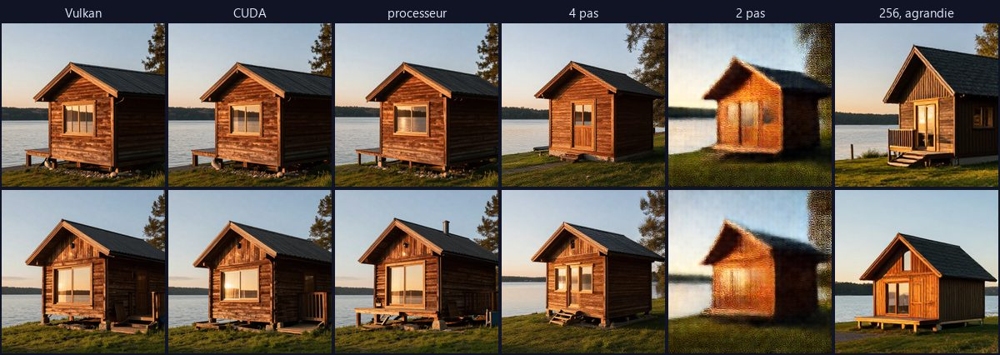

# Vérifier une image calculée ailleurs : mesures du 18/10/2026

Complète le § 5 de [phase3-reseau-public.md](phase3-reseau-public.md), qui disait des
images : « à mesurer avant d'en faire une règle ». Outil : `tools/bench_image_verify.py` ;
résultats bruts : [phase3-verification-images.json](phase3-verification-images.json).
Rien n'est codé de la phase 3 : ceci prépare une décision.

## 1. Protocole

- **Modèle** : Z-Image Turbo (8 pas), 512 × 512, quatre consignes (cabane au coucher du
  soleil, portrait d'un marin, chat sous la pluie, rue de nuit aux néons) × deux graines.
  Les images sont demandées à sd-server comme AIODOS le fait (`generate.request_body`).
- **Moteurs** : stable-diffusion.cpp master-973 (f0aac52), en Vulkan et en CUDA sur la même
  carte (RTX 4070 Laptop), et sur le processeur (i9-14900HX, `--backend cpu`, deux images).
  Deux images refaites une deuxième fois par chaque moteur de la carte.
- **Tricheries** d'une machine qui voudrait s'épargner le calcul : 4 pas au lieu de 8,
  2 pas, image calculée en 256 × 256 puis agrandie, autre graine, autre consigne, image
  unie, bruit ; et une image « floue » (la vraie, réduite à 64 pixels puis agrandie), pour
  voir ce que chaque mesure regarde.
- **Distances** à l'image Vulkan : empreintes perceptuelles pHash (63 bits) et dHash
  (64 bits), SSIM moyen sur des blocs de 8 × 8 en niveaux de gris, PSNR. **Contenu** de
  chaque image : écart type de la luminance, compressibilité (zlib), part des hautes
  fréquences.

## 2. Résultats

| Comparaison (8 cas, sauf mention) | pHash | dHash | SSIM | PSNR (dB) |
|---|---|---|---|---|
| **Même moteur, deux fois** (Vulkan 2, CUDA 2) | 0 | 0 | 1,000 | identiques au pixel près (4 sur 4) |
| Vulkan / CUDA | 0 à 10 | 2 à 10 | 0,78 à 0,92 | 19,8 à 27,0 |
| Carte / processeur (4) | 2 à 4 | 2 à 12 | 0,73 à 0,82 | 17,6 à 20,5 |
| 4 pas au lieu de 8 | 4 à 16 | 3 à 13 | 0,50 à 0,73 | 14,6 à 20,4 |
| 2 pas au lieu de 8 | 10 à 20 | 10 à 17 | 0,26 à 0,42 | 12,2 à 15,9 |
| Calculée en 256, agrandie | 14 à 36 | 20 à 33 | 0,17 à 0,39 | 10,0 à 12,5 |
| Autre graine | 12 à 24 | 16 à 23 | 0,20 à 0,39 | 10,7 à 12,5 |
| Autre consigne | 26 à 38 | 23 à 37 | 0,17 à 0,34 | 6,5 à 10,4 |
| Unie (couleur moyenne) | 22 à 38 | 21 à 35 | 0,32 à 0,40 | 10,1 à 12,6 |
| Bruit | 26 à 36 | 23 à 37 | 0,01 à 0,02 | 6,9 à 8,5 |
| Floue (tirée de la vraie) | 0 à 2 | 0 à 1 | 0,57 à 0,74 | 20,1 à 27,1 |

Temps moyens par image (512 × 512) : Vulkan 5,2 s, CUDA 4,3 s, **processeur 191 s**
(37 fois plus lent) ; 4 pas 3,0 s, 2 pas 1,7 s, 256 × 256 2,1 s.

Contenu : les vraies images ont un écart type de 49 à 75, une compressibilité de 0,72 à
0,85 et une part de hautes fréquences de 0,06 à 0,20 ; l'image unie, 0 et 0,001 ; le
bruit, 0,89 de hautes fréquences.

*Même consigne (cabane au bord d'un lac), deux graines. Les trois moteurs donnent la même
scène, pas les mêmes détails (en bas, le processeur ajoute une cheminée) ; « 4 pas » change
la cabane mais reste crédible ; « 2 pas » est flou ; « 256, agrandie » est une autre image.*

## 3. Ce que cela veut dire

1. **Le même moteur, sur la même machine, refait l'image au pixel près.** Un contrôle
   exact est donc possible quand la machine qui vérifie a le même moteur (même version de
   stable-diffusion.cpp, même backend). Entre deux cartes différentes avec le même backend
   (une NVIDIA et une AMD en Vulkan, par exemple) : pas mesuré, il n'y a qu'une carte ici.
   À refaire avec une deuxième machine (le deuxième PC, ou celui d'un ami).
2. **Deux moteurs différents donnent la même scène, pas les mêmes pixels** (planche
   ci-dessus). Les empreintes perceptuelles seules ne
   séparent pas l'honnête de la tricherie : Vulkan / CUDA va jusqu'à 10 bits de pHash,
   autant que « 2 pas ». Le **SSIM** sépare mieux : 0,73 au plus bas pour un calcul
   honnête, 0,42 au plus haut pour les tricheries grossières (2 pas, plus petite, autre
   graine, autre consigne, unie, bruit).
3. **Ce qu'un recalcul sur un autre moteur ne voit pas : la moitié des pas.** Avec un
   modèle « Turbo », 4 pas donnent déjà une image correcte, proche de celle à 8 pas (SSIM
   jusqu'à 0,73, autant que le pire écart honnête) ; elle épargne 43 % du temps. Seul le
   contrôle exact (même moteur) la verrait. L'image « floue » montre que pHash ne regarde
   que les basses fréquences ; elle ne se fabrique pas sans calculer la vraie image, ce
   n'est donc pas une tricherie possible, seulement une limite de la mesure.
4. **Sans rien recalculer**, une image unie ou du bruit se voient à leur contenu (écart
   type et compressibilité proches de zéro ; hautes fréquences à 0,89 au lieu de 0,21 au
   plus).
5. **Une machine sans carte graphique ne doit pas recevoir d'images** : 191 s au lieu de
   5 (même conclusion que pour les gros modèles répartis).

## 4. Règle proposée (à valider)

- **Toujours** (déjà en place pour mes machines et mes amis : taille, format,
  `jobs/kinds/images.check_image`) ; en plus pour le public, le **contenu** : écart type
  > 5, compressibilité > 0,05, hautes fréquences < 0,5 (larges marges).
- **Un échantillon recalculé** (nouveau venu : une image sur cinq ; puis 5 %, puis 1 %,
  comme au § 5 du plan) :
  - même moteur déclaré (version de sd.cpp, backend, carte) : **égalité exacte** exigée ;
  - sinon : **SSIM ≥ 0,60** (honnête ≥ 0,73 mesuré, tricheries grossières ≤ 0,42 : une
    marge de chaque côté). Les « 4 pas » passent en partie : risque accepté, ou réservé
    aux vérifications par le même moteur.
- **Un écart** met la clé de côté (comme pour les amis : `jobs/kinds/index.py`), et la
  réputation (§ 5 du plan) décide de la suite.

## 5. Limites et suites

- Une seule carte, un seul modèle, 512 × 512, huit cas (et deux au processeur). À refaire
  avec une autre carte (AMD ou Intel en Vulkan), en 1024 × 1024, et pour la vidéo (Wan :
  une distance par image, ou sur quelques images tirées au sort).
- **Idée, non mesurée : vérifier un pas tiré au sort.** La machine qui calcule rendrait
  aussi ses états intermédiaires ; celle qui vérifie en referait un seul, tiré au sort, et
  comparerait le suivant : un huitième du coût, et les pas sautés se verraient. Il faudrait
  que le moteur expose ces états (l'API de sd-server ne le fait pas aujourd'hui).
- Les images de la mesure ne sont pas gardées dans le dépôt (elles se refont avec l'outil
  en vingt minutes, dont treize au processeur).
